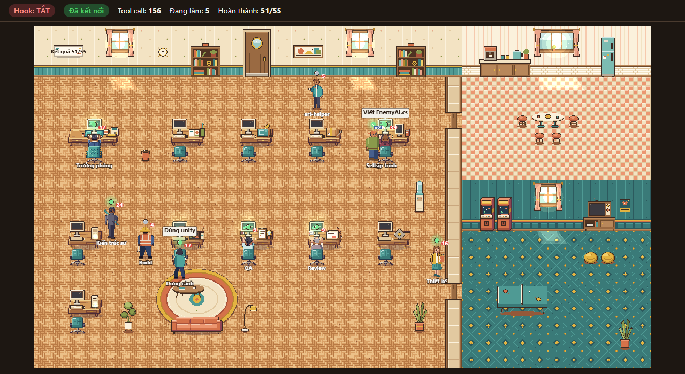

# Pixel Office

Pixel Office là một văn phòng pixel art chạy ngay trên máy bạn, dùng để xem các subagent của Claude Code làm việc theo thời gian thực. Mỗi agent là một nhân vật ngồi ở một bàn, và trạng thái của nhân vật đổi theo việc agent đang làm: đọc file, sửa code, chạy lệnh, chờ bạn duyệt quyền, hay bị lỗi.

- Chạy hoàn toàn local tại http://127.0.0.1:4848. Không gửi dữ liệu đi đâu, không cần tài khoản.
- Không cần `npm install`, chỉ cần Node.
- Bật hoặc tắt chỉ bằng một lệnh. Khi tắt, cấu hình Claude Code trở lại y như trước.

## Ảnh demo



*Ảnh chụp khi chạy `office demo`.*

- **Thanh trên cùng:** trạng thái hook và kết nối, tổng số tool call, số agent đang làm, và số việc đã hoàn thành.
- **Nhân vật:** mỗi subagent là một nhân vật, có tên vai trò bên dưới (Trưởng phòng, Thiết kế, Lập trình, Dựng cảnh, QA…). Con số đỏ là số tool call của agent đó.
- **Bong bóng chữ:** việc agent đang làm, ví dụ `Viết EnemyAI.cs` hay `Dùng unity`.
- **Vị trí:** agent đang làm việc thì ngồi vào bàn, agent rảnh thì đi lại hoặc sang phòng ăn và phòng giải trí.

## Yêu cầu

- [Node.js](https://nodejs.org) 18 trở lên.
- Claude Code.
- Chạy được trên Windows, macOS và Linux.

## Cài đặt

Trong hướng dẫn này, **`<project>`** là thư mục bạn mở Claude Code để làm việc (ví dụ `E:\UnityProject` hoặc `~/code/my-game`).

1. Đặt repo này vào `<project>/tools/pixel-office`:
   ```
   git clone <url-repo> <project>/tools/pixel-office
   ```
2. Cài lệnh `/office` để dùng được trong chat Claude:
   ```
   node <project>/tools/pixel-office/cli.js install
   ```
   Lệnh này tạo file `<project>/.claude/commands/office.md`. File dùng đường dẫn tương đối, nên bạn có thể commit nó vào repo project: người khác clone về ở thư mục nào cũng dùng được.

Xong. Bạn không cần cấu hình gì thêm, vì công cụ tự lấy thư mục hai cấp phía trên `cli.js` làm project.

## Sử dụng hằng ngày

1. **Bật:** gõ `/office on` trong chat Claude, hoặc chạy `node tools/pixel-office/cli.js on` từ `<project>`. Trình duyệt sẽ tự mở văn phòng.
2. **Làm việc như bình thường** trong Claude Code. Mỗi khi Claude gọi subagent, một nhân vật mới sẽ vào văn phòng.
3. **Tắt khi xong:** `/office off`. Khi tắt, hook được gỡ và server dừng hẳn, không tốn tài nguyên.

Chưa có agent nào chạy mà muốn xem thử? Dùng `/office demo` để phát một kịch bản mẫu dài khoảng 1–2 phút, xem xong thì `/office off`.

## Các lệnh

Bạn có thể gõ trong chat (`/office <lệnh>`) hoặc chạy trong terminal (`node <project>/tools/pixel-office/cli.js <lệnh>`). Trên Windows, khi đang ở trong thư mục này, có thể gõ ngắn `office <lệnh>`.

| Lệnh | Tác dụng |
|---|---|
| `on` | Gắn hook theo dõi vào project, bật server, mở trình duyệt. Có hiệu lực ngay, kể cả với phiên Claude đang mở. |
| `off` | Gỡ hook, tắt server. Cấu hình trở lại y như trước. |
| `status` | Cho biết project đang dùng, hook đang bật hay tắt, server có chạy không, và đã nhận bao nhiêu sự kiện. |
| `demo` | Phát kịch bản mẫu để xem thử. Lệnh này không đụng tới hook. |
| `install` | Cài lệnh `/office` vào project. |

| Tuỳ chọn | Tác dụng |
|---|---|
| `--project <thư mục>` | Dùng cho một thư mục khác với mặc định. Nhớ dùng cùng giá trị cho cả `on` và `off`. |
| `--force` | Cho phép `install` ghi đè `office.md` đã có. |

Công cụ chọn project theo thứ tự ưu tiên: `--project`, rồi biến môi trường `CLAUDE_PROJECT_DIR`, rồi thư mục hai cấp phía trên `cli.js`.

| Biến môi trường | Mặc định | Ý nghĩa |
|---|---|---|
| `OFFICE_PORT` | `4848` | Cổng của server. |
| `OFFICE_NO_BROWSER` | — | Đặt `1` để không tự mở trình duyệt. |
| `OFFICE_DEBUG` | — | Đặt `1` để ghi payload hook thô vào `data/raw.jsonl`. File này chứa toàn bộ nội dung, nên chỉ bật khi cần. |

## Làm việc ở thư mục con

Claude Code chỉ đọc hook của **đúng thư mục** bạn mở phiên. Nếu bạn mở Claude ở một thư mục con (ví dụ `<project>/DemoGame`), hãy bật thêm cho thư mục đó:

```
node <project>/tools/pixel-office/cli.js on --project <project>/DemoGame
node <project>/tools/pixel-office/cli.js off --project <project>/DemoGame
```

## Câu hỏi thường gặp

**Văn phòng không cập nhật?** Chạy `status`:
- `Hook: TẮT` nghĩa là chưa bật, hoặc bạn đang mở Claude ở thư mục khác. Xem mục [Làm việc ở thư mục con](#làm-việc-ở-thư-mục-con).
- `Project:` sai thư mục thì truyền `--project` cho đúng.

**Mỗi tool call của Claude hiện dòng `hook error … ECONNREFUSED`?** Lỗi này xảy ra khi server đã tắt nhưng hook vẫn còn. Claude vẫn chạy bình thường, chỉ bị báo lỗi. Chạy `on` để bật lại server, hoặc `off` để gỡ hook. Luôn tắt bằng `off` để gỡ hook và tắt server cùng lúc.

**Báo `Cổng 4848 đang bị chiếm`?** Một chương trình khác đang dùng cổng 4848. Đặt `OFFICE_PORT` sang cổng khác, và dùng cùng cổng đó cho cả `on` lẫn `off`.

**Trình duyệt không tự mở?** Lệnh sẽ in ⚠ kèm địa chỉ. Bạn mở tay http://127.0.0.1:4848.

**`install` báo `office.md đã có và khác bản trong repo`?** Project đã có một lệnh `/office` khác. Xem lại file đó trước, rồi chạy `install --force` nếu muốn thay bằng bản này.

**`/office` không có trong chat?** Lệnh này chỉ có ở phiên Claude mở tại `<project>`, sau khi đã chạy `install`. Ở chỗ khác thì dùng `node .../cli.js` như trên.

**Agent đang chờ duyệt quyền nhưng nhân vật khác lại hiện trạng thái chờ?** Khi Claude Code hỏi quyền, nó không cho biết agent nào đang hỏi. Văn phòng tạm gán trạng thái chờ cho agent đang có tool call dở.

## Cấu hình hook bằng tay

`on` tự ghi hook vào `<project>/.claude/settings.local.json`. File này thường nằm trong `.gitignore`, nên mỗi máy bật hoặc tắt riêng. Nếu muốn tự gắn hook mà không dùng `cli.js`, hãy dùng file mẫu [examples/settings.local.example.json](examples/settings.local.example.json):

- Nếu project **chưa có** `settings.local.json`: chép file mẫu sang `<project>/.claude/settings.local.json`.
- Nếu **đã có**: gộp các mục trong `hooks` vào file sẵn có. Đừng ghi đè, để giữ nguyên `permissions` và các cài đặt khác.
- Nếu dùng cổng khác: sửa `4848` trong mọi `url`.
- Khi gỡ: xoá các hook có `url` là `http://127.0.0.1:4848/hook`. Nếu file chỉ còn `{}` thì xoá luôn file.

> Đừng đặt file mẫu ở đúng tên `.claude/settings.local.json` trong repo này, vì Claude Code sẽ đọc nó và gắn hook thật.

## Gỡ cài đặt

1. Chạy `off` để gỡ hook và tắt server.
2. Xoá `<project>/.claude/commands/office.md`.
3. Xoá thư mục `<project>/tools/pixel-office`.

## Dành cho người phát triển

- Chạy test: `node --test` trong thư mục này.
- Server nhận hook `type: "http"` của Claude Code tại `POST /hook`, còn trạng thái văn phòng nằm ở `GET /api/state`.
- Sprite được vẽ bằng MCP pixelart local. Xem thêm trong `docs/`.
